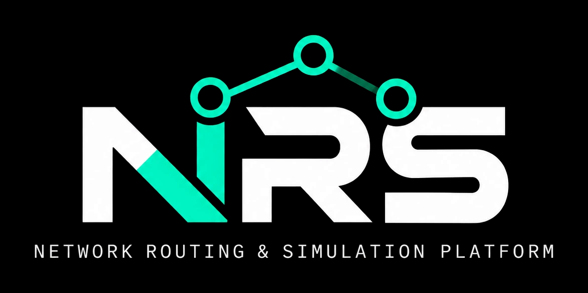
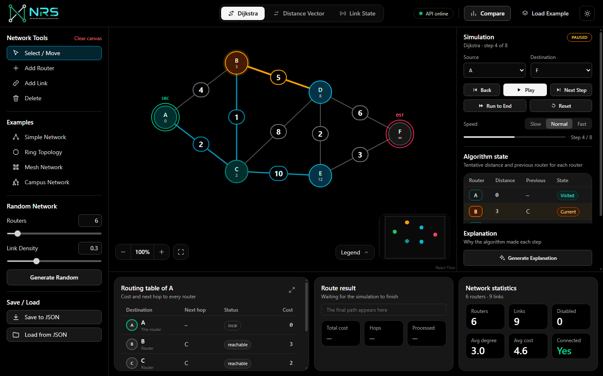
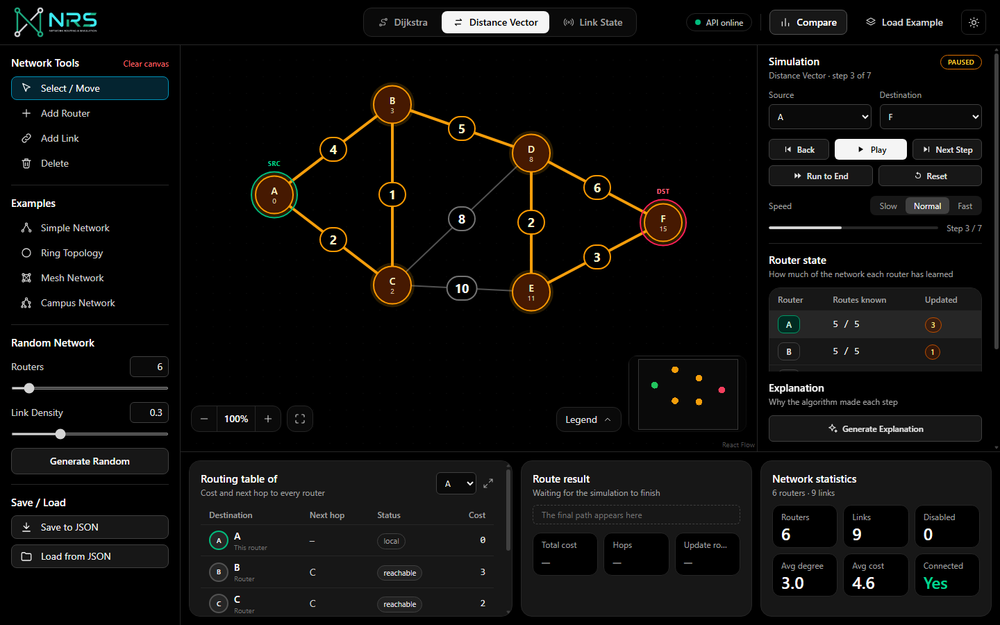
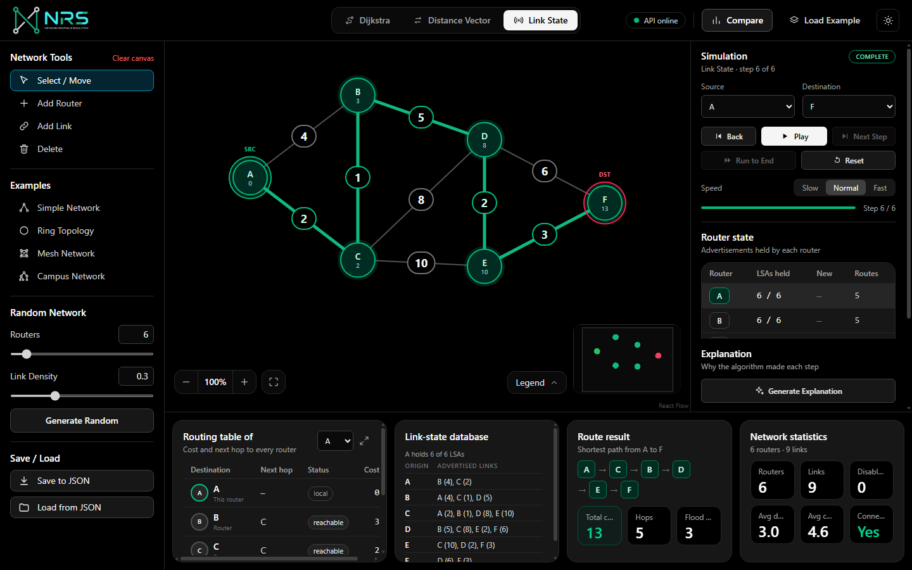
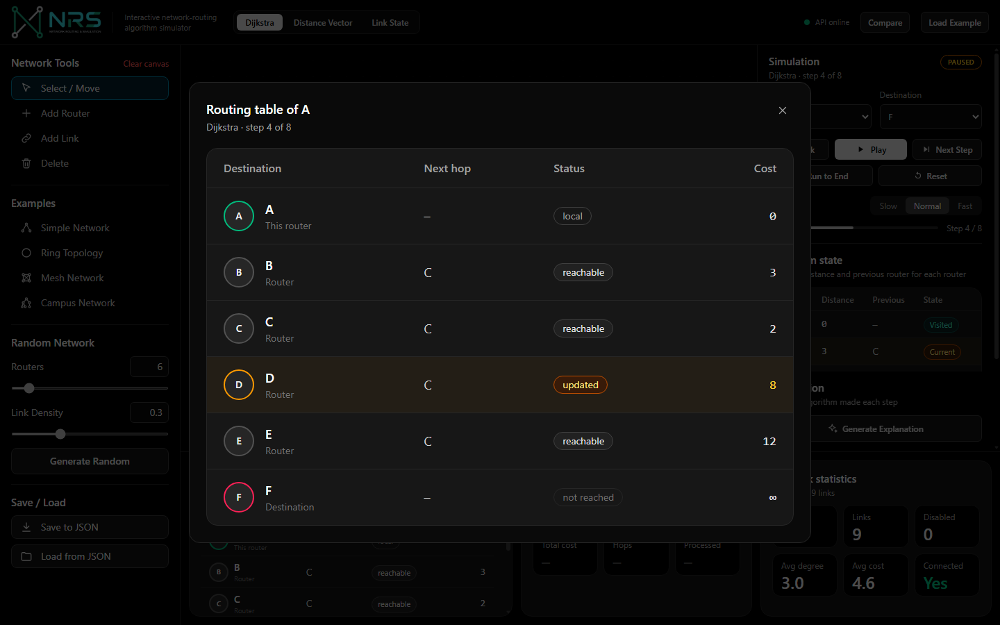
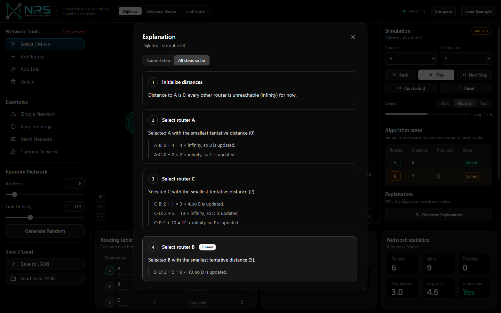
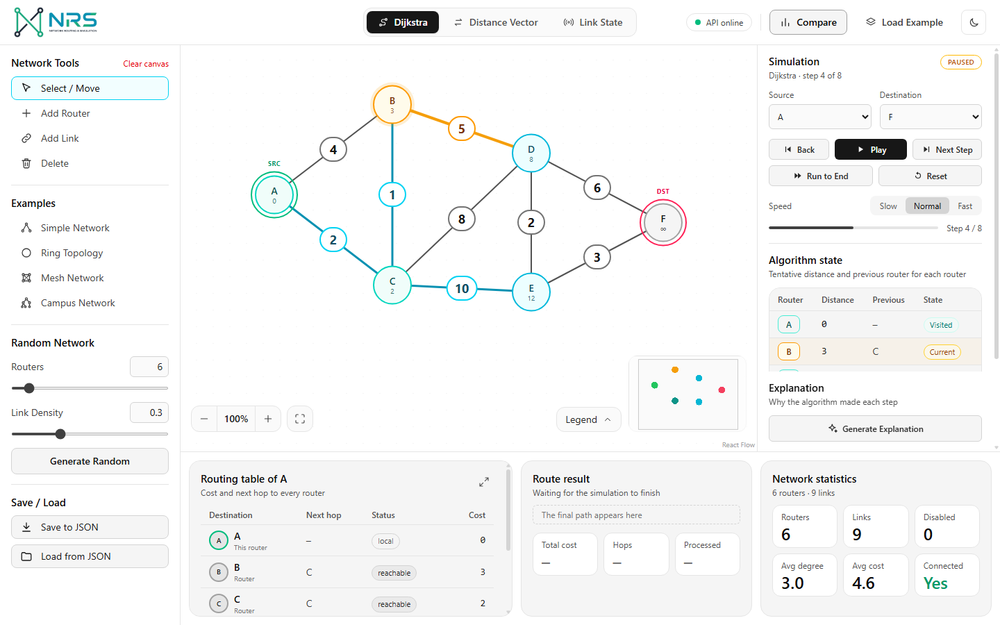

<p align="center">
  
</p>

# NRS - Network Routing & Simulation Platform

NRS is an interactive web app for learning how routing algorithms work. You build a small weighted network of routers, pick a source and a destination, choose a routing mode and step through the algorithm to see how the route is selected.

It is a teaching simulator. It does not emulate real routers, capture traffic or implement production OSPF.



## Features

- **Three routing modes** on the same topology: Dijkstra shortest path, Distance Vector and Link State.
- **Step-by-step simulation** with Play, Pause, Next Step, Back, Run to End, Reset and a speed control. Every step can be explained in plain language: press **Generate Explanation** for a window with the current step or all steps so far.
- **Dark and light themes** with a toggle in the top bar. The choice is remembered.
- **Canvas** with zoom controls, a fit-to-view button, a collapsible legend and a mini map that shows where you are in large networks. Fitting a network always leaves room for these controls.
- **Topology builder**: add, drag, rename and delete routers; add links; edit link costs; disable and restore links to simulate failures.
- **Routing tables** (with an expand button for a full-size view), link-state database, path, total cost, hop count and iteration counts.
- **Presets** (Simple, Ring, Mesh, Campus) and a **random connected network** generator (up to 50 routers, laid out so links do not cross or overlap).
- **Comparison panel** that runs all three algorithms on the same network.
- **Re-run prompt** after you edit a finished simulation, and **JSON save/load** of topologies.

| Distance Vector | Link State |
| --- | --- |
|  |  |







## Tech stack

| Layer | Technology |
| --- | --- |
| Frontend | React, Vite, Tailwind CSS, React Flow |
| Backend | Python, FastAPI |
| Algorithms | Plain Python modules (no graph library) |
| Data | JSON, in memory (no database) |

The backend generates the full list of simulation steps for a request. The frontend only animates and renders them.

## Getting started

You need Python 3.10 or newer and Node.js 18 or newer.

### 1. Start the backend

```bash
cd backend
python -m venv .venv
.venv/Scripts/pip install -r requirements-dev.txt
.venv/Scripts/python -m uvicorn app.main:app --reload
```

On macOS or Linux use `.venv/bin/pip` and `.venv/bin/python` instead of `.venv/Scripts/...`.

The API runs on http://127.0.0.1:8000. Interactive API docs are at http://127.0.0.1:8000/docs.

### 2. Start the frontend

In a second terminal:

```bash
cd frontend
npm install
npm run dev
```

Open http://localhost:5173 for the landing page and press **Open simulator** (or go straight to http://localhost:5173/app). The top bar shows "API online" when the frontend can reach the backend. The dev server proxies `/api` to port 8000.

## Using the app

1. Pick an example (Simple Network is loaded by default) or build your own with **Add Router** and **Add Link** in the left panel. The **Delete** tool removes any router or link you click.
2. Choose a **Source** and **Destination** in the right panel.
3. Choose a mode in the top bar: Dijkstra, Distance Vector or Link State.
4. Press **Play**, or **Next Step** to go one step at a time. **Back** goes one step back and **Reset** returns to the unsimulated network.
5. Double-click the cost on a link to type a new value (Enter saves, Escape cancels). Click a link and use **Disable link** to simulate a failure. Press **Re-run** when the prompt appears to see how the route changes.
6. Press **Compare** in the top bar to see all three algorithms side by side.

Click a router in Distance Vector or Link State mode to inspect its routing table or link-state database.

## Tests

Backend (pytest):

```bash
cd backend
.venv/Scripts/python -m pytest
```

Frontend (helper tests, lint and build):

```bash
cd frontend
npm test
npm run lint
npm run build
```

A manual UI checklist is in [docs/testing.md](docs/testing.md).

## Project structure

```
NRS/
  backend/
    app/
      algorithms/      dijkstra.py, distance_vector.py, link_state.py, common.py
      api/             simulations.py, topologies.py
      models/          topology.py
      services/        graph_manager.py, simulation_service.py, topology_generator.py
      main.py
    tests/
  frontend/
    src/
      components/      canvas, panels, comparison dialog, re-run prompt
      hooks/           useTopology, useSimulation, useBackendStatus
      pages/           Landing.jsx, Workspace.jsx
      services/        api.js
      utils/           presets, view-model helpers, topology file helpers
  docs/
```

## API

| Method | Endpoint | Purpose |
| --- | --- | --- |
| GET | `/api/health` | Backend health check |
| POST | `/api/simulations/validate` | Validate a topology and a route request |
| POST | `/api/simulations/dijkstra` | Dijkstra simulation steps |
| POST | `/api/simulations/distance-vector` | Distance Vector simulation steps |
| POST | `/api/simulations/link-state` | Link State simulation steps |
| POST | `/api/simulations/compare` | Run all three and summarize |
| POST | `/api/topologies/random` | Generate a connected random topology |

Details and the shape of each simulation step are in [docs/api.md](docs/api.md).

## Documentation

- [Algorithms](docs/algorithms.md): how each mode works and how it is implemented
- [API reference](docs/api.md): endpoints and step formats
- [Testing](docs/testing.md): automated tests and a manual checklist
- [Contributing](CONTRIBUTING.md): how to run the project and open a pull request

## Scope

In scope: the three routing modes, step-by-step visualization, failure simulation and comparison.

Out of scope: real router configuration, packet capture, a production OSPF implementation, accounts and a database.

## Contributing

Ideas and pull requests are welcome. See [CONTRIBUTING.md](CONTRIBUTING.md).

## License

Released under the [MIT License](LICENSE).
